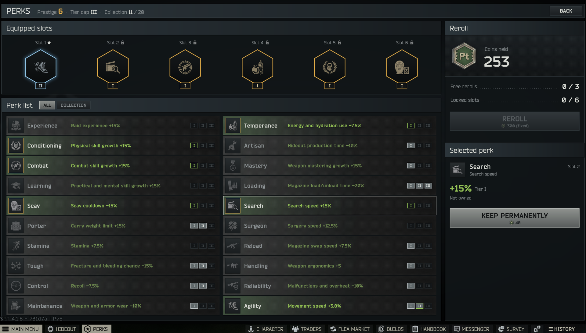
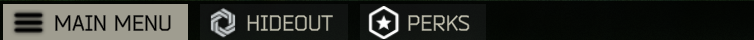
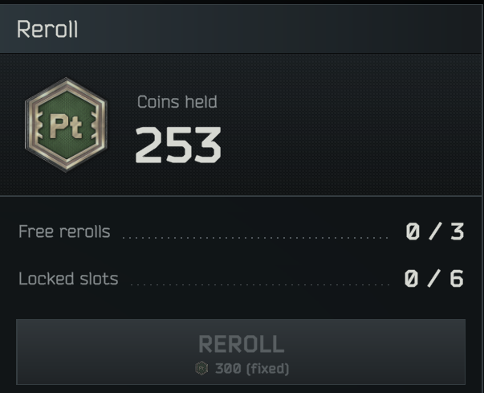
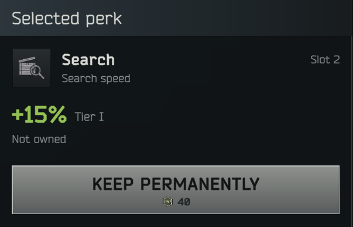
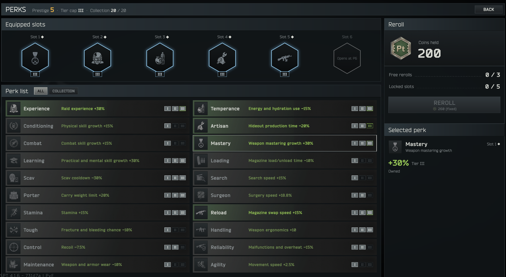
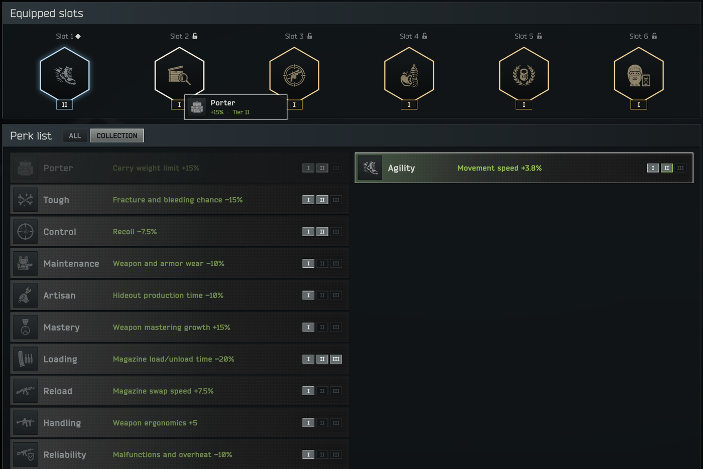
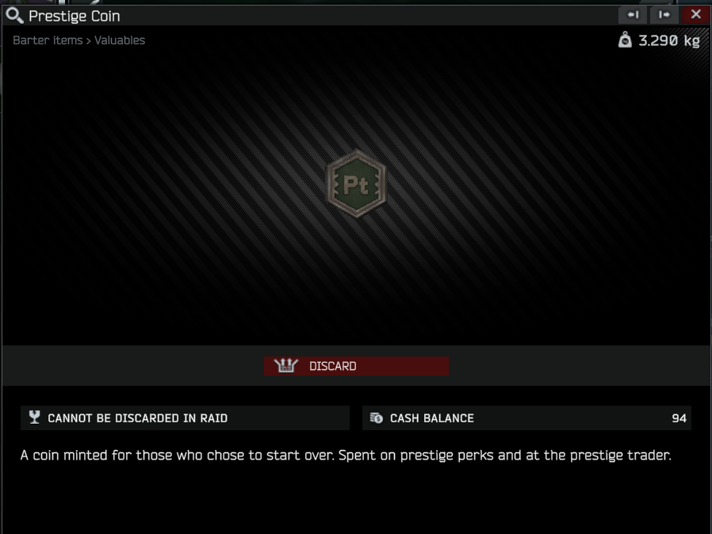
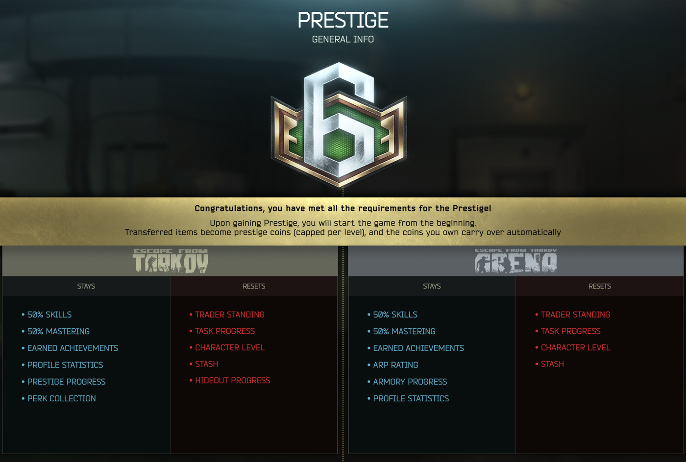
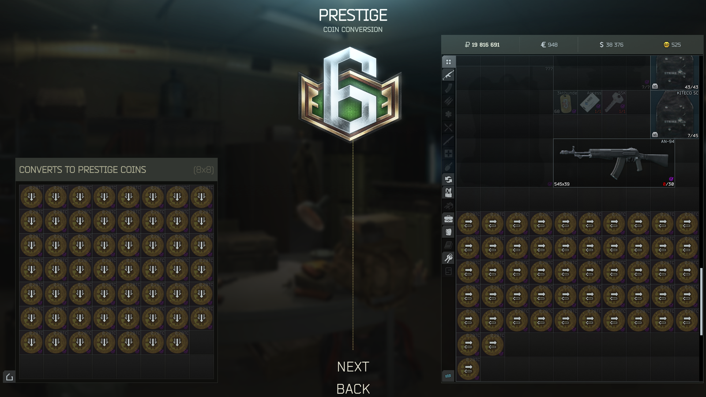
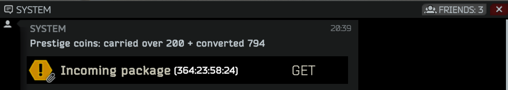

# PrestigePerks

**Language: [English](README.md) | [한국어](README.kr.md)**

## Purpose

A prestige overhaul for SPT 4.1. In vanilla, prestiging mostly wipes your character. With PrestigePerks every
prestige leaves you a little stronger for the next run:

- **Lower prestige requirements**, close to EFT 1.0, with all six prestige levels (P1–P6).
- **Perk slots**: one more slot per prestige level. Slots are filled by random rolls you can lock and reroll.
  Keep the perks you like with coins, upgrade them from tier I to III, and drop them into slots so rerolls leave
  them alone.
- **Prestige coins**: the items you hand over when you prestige turn into coins, and the coins you already have
  carry over to your next prestige. You also find coins in safes and on bosses.

Perks work for your own PMC only. Scav raids and AI bots are not affected.

## Requirements

- SPT `4.1.x` (4.1.2 or later)
- [Content Backport - Prestiges](https://github.com/ArchangelWTF/ContentBackportPrestiges) `1.1.0` or later.
  It adds prestige levels 5–6 and the New Beginning quests.
- WTT-CommonLib `3.x` and WTT-ContentBackport `2.0.x` (server and client). These are what Content Backport -
  Prestiges itself needs.

PrestigePerks has a server mod and a client plugin. You need both.

## Installation

1. Install the required mods first.
2. Download `PrestigePerks-<version>.zip` from [Releases](../../releases).
3. Extract it and overwrite the resulting `SPT_Runtime` and `BepInEx` folders into your SPT install root (the
   folder containing `EscapeFromTarkov.exe`).
   - Server mod: `SPT_Runtime/user/mods/PrestigePerks/...`
   - Client plugin: `BepInEx/plugins/PrestigePerks/...`
   - If your server root is the `SPT_Runtime` folder itself (older SPT layout), copy
     `SPT_Runtime\user\mods\PrestigePerks` into your server root's `user\mods\` instead.
4. Restart the server and the game.

When you update, the zip overwrites `config/config.json`. Back it up first if you changed it.

## Opening it

Press the **PERKS** button in the bottom taskbar of the main menu, next to Hideout. The page opens any time outside
a raid.

The page follows the game language: Korean, English for everything else.

## Prestige requirements

| Prestige | Level | Quests | Skills | Hideout | Roubles | Kept progress |
|---|---|---|---|---|---|---|
| P1 | 15 | New Beginning | — | — | 5,000,000 | 10% |
| P2 | 25 | New Beginning | Strength 10 · Endurance 10 · Charisma 7 | Intelligence Center 1 · Rest Space 2 · Nutrition Unit 2 | 10,000,000 | 20% |
| P3 | 35 | New Beginning | Strength 10 · Endurance 10 · Charisma 7 | Intelligence Center 1 · Rest Space 2 · Nutrition Unit 2 | 12,000,000 | 30% |
| P4 | 40 | New Beginning | Strength 15 · Endurance 15 · Charisma 12 | Intelligence Center 1 · Rest Space 2 · Nutrition Unit 2 | 15,000,000 | 40% |
| P5 | 47 | New Beginning · Collector | Strength 20 · Endurance 20 · Charisma 20 | Intelligence Center 2 · Security 3 · Rest Space 3 | 20,000,000 | 50% |
| P6 | 47 | New Beginning · Collector | Strength 20 · Endurance 20 · Charisma 20 | Intelligence Center 2 · Security 3 · Rest Space 3 | 20,000,000 | 50% |

- **Kept progress** is how much of your skill and weapon mastering progress stays after the prestige.
- Levels, skills, hideout and kept progress match SPT 5.0. Only the P3 rouble requirement is lower (5.0 asks for
  15,000,000).
- New Beginning is the prestige quest from Content Backport - Prestiges (Ragman). PrestigePerks only lowers the
  start level of the P1 and P2 quests to 15 and 25 so they open at the prestige level. The quests themselves are
  unchanged.
- Collector is not changed. Quests and trader standing reset on every prestige, so you do it twice, at P5 and P6.
- The XP table and the XP and skill rates are not changed.

## Perks

### Slots

| Prestige | P1 | P2 | P3 | P4 | P5 | P6 |
|---|---|---|---|---|---|---|
| Slots | 1 | 2 | 3 | 4 | 5 | 6 |
| Tier cap | I | I | II | II | III | III |

- The first time you log in after a prestige, the new slot is rolled for you and applies at once.
- A slot holds one perk, and the same perk never appears twice. There are no negative perks.
- Perks, locks and owned tiers stay through every prestige.
- If you were already past P1 before installing, you get all your slots rolled and 3 free rerolls on the first login.

### Rerolling and locking

- **REROLL** rolls every slot again except locked slots and slots holding an owned perk. The result applies at once.
- Click a slot to lock it so rerolls skip it.
- You get **3 free rerolls per prestige level**. They refill to 3 when you prestige (unused ones don't pile up).
- After that, rerolls cost prestige coins from your inventory. The cost is shown under the button before you press it:

  `cost = base price × (1 + 0.5 × locked slots) × 2^(paid reroll number − 1)`, rounded up

  | Prestige | P1 | P2 | P3 | P4 | P5 | P6 |
  |---|---|---|---|---|---|---|
  | Base price (coins) | 25 | 35 | 45 | 55 | 65 | 75 |

  The paid count starts over at each prestige level, and from the 3rd paid reroll on the cost stays fixed
  (`(fixed)` under the button). Example at P1 with no locks: 25, 50, then 100 each time.
- Rerolls only roll perks you don't own yet. When you own them all, there is nothing left to roll.

### Collection and tiers

- **KEEP PERMANENTLY** (tier I, **40 coins**) buys a perk a reroll put in one of your slots. It goes into your
  **collection** for good, and that slot becomes a fixed slot that rerolls leave alone. You can only buy a perk while
  it is in a slot, so once a reroll pushes it out you have to wait for it to come up again.
- **BUY TIER II** (**100 coins**) and **BUY TIER III** (**200 coins**) upgrade an owned perk any time, up to your tier
  cap. Purchases are permanent and can't be refunded. Buttons buy on the first click, without a confirmation.
- Effect by tier: **III is the full value** in the list below, II is 75% of it and I is 50%. Perks you don't own (rolled
  or locked slots) work at tier I. Owned perks work at their tier, limited by the tier cap.
- The **COLLECTION** tab shows only the perks you own.

A finished collection at P5: every slot holds an owned perk at tier III, and slot 6 opens at P6.

### Fixed slots

- Drag an owned perk from the list onto a rolled or empty slot to fix it there. The perk that was rolled in that slot
  is gone.
- Dropping it on another fixed slot swaps the two. You can't drop on a locked slot, so you can't lose a locked perk by
  accident.
- Drag a fixed slot back onto the list to take the perk out. You keep owning it, and the empty slot is filled on the
  next reroll.
- Putting perks in and taking them out is free.

### Perk list

Values for tier I / II / III. "pp" means the value is added to the game's own bonus (from skills and hideout), not
multiplied.

| Perk | Effect | I | II | III |
|---|---|---|---|---|
| Experience | Raid experience | +15pp | +22.5pp | +30pp |
| Conditioning | Physical skill growth (Strength, Endurance…) | +15pp | +22.5pp | +30pp |
| Combat | Combat skill growth | +15pp | +22.5pp | +30pp |
| Learning | Practical and mental skill growth (incl. Charisma) | +15pp | +22.5pp | +30pp |
| Scav | Scav cooldown | −15pp | −22.5pp | −30pp |
| Porter | Carry weight limit | +10pp | +15pp | +20pp |
| Stamina | Stamina | +7.5pp | +11.3pp | +15pp |
| Tough | Fracture and bleeding chance | −10% | −15% | −20% |
| Control | Recoil | −5pp | −7.5pp | −10pp |
| Maintenance | Weapon wear when firing, armor wear when hit | −10% | −15% | −20% |
| Temperance | Energy and hydration use in raid | −7.5% | −11.3% | −15% |
| Artisan | Hideout production time (crafts, Scav case, Cultist circle, Bitcoin farm) | −10% | −15% | −20% |
| Mastery | Weapon mastering growth | +15% | +22.5% | +30% |
| Loading | Magazine load/unload time | −10% | −15% | −20% |
| Search | Search speed | +15% | +22.5% | +30% |
| Surgeon | Surgery speed | +12.5pp | +18.8pp | +25pp |
| Handling | Weapon ergonomics | +5 | +7.5 | +10 |
| Reliability | Malfunction chance and heat per shot | −10% | −15% | −20% |
| Reload | Magazine swap speed | +7.5% | +11.3% | +15% |
| Agility | Walking and sprinting speed | +2.5% | +3.8% | +5% |

- Experience and the three skill growth perks grow further with Hideout Management (up to +45% at tier III).
- Handling helps low-ergonomics builds most. Ergonomics still stops at 100.
- Scav is a PMC perk: it shortens the cooldown before your next Scav raid.

## Prestige coins

- Currency item, stacks to 100. It can't be insured or sold to traders or on the flea market.
- **1 coin = 100,000 roubles** of handbook value.
- Spent on paid rerolls and perk tiers. Pay from your inventory, like a trader purchase.

### When you prestige

The prestige screen tells you about the coins, and lists your perk collection under **STAYS**.

- **Conversion**: every item you put in the prestige transfer window is turned into coins instead of being sent
  over: handbook price total ÷ 100,000. Attachments and container contents count too. Durability doesn't matter,
  and items without a handbook price count as 0.
- **Cap**: conversion is capped at what a transfer window full of Bitcoins is worth. Anything above the cap is lost,
  and the mail tells you how much.

  | Prestige | P1 | P2 | P3 | P4 | P5 | P6 |
  |---|---|---|---|---|---|---|
  | Transfer window | 8×3 | 8×4 | 8×5 | 8×6 | 8×7 | 8×8 |
  | Cap (coins) | 346 | 462 | 577 | 693 | 808 | 924 |

  The cap is calculated from the window size and the Bitcoin handbook price, so it follows if either changes.
- **Carry-over**: all coins you own go along 1:1 with no cap: PMC inventory (stash, gear, containers, secure
  container), Scav inventory, unclaimed mail and BTR deliveries.
- Both come in one mail right after the prestige ("carried over N + converted M"), kept for one year. The mail text
  is in English.

### In raid

- **Safes**: each safe has a 30% chance of 5–15 coins (also in Scav raids).
- **Bosses**: each of the 13 bosses (followers excluded) has about a 23% chance of 20–35 coins. If another mod puts
  GP coins in boss pockets, the two share the same draw: about 12.5% for 40–60 coins each.
- Reshala's pockets are usually full of spare magazines, so he rarely carries coins.
- Coins don't appear in airdrops or on PMC bots.

## Settings

`SPT_Runtime/user/mods/PrestigePerks/config/config.json`. Restart the server after editing. Out-of-range values are
clamped to the nearest valid value with a warning in the server log, and a broken section falls back to its
defaults.

**`perks`**

| Key | Default | Description |
|---|---|---|
| `prestigeLevel0Slots` … `prestigeLevel6Slots` | 0, 1, 2, 3, 4, 5, 6 | Slots open at each prestige level (0–6). `prestigeLevel0Slots` is before the first prestige. Set P1 to 6 to get all slots right away |
| `freeRerolls` | 3 | Free rerolls per prestige level (0–99) |
| `rerollBasePrice` | 25, 35, 45, 55, 65, 75 | Paid reroll base price per prestige level (P1–P6) |
| `lockCostStep` | 0.5 | Extra cost per locked slot |
| `paidCostGrowth` | 2 | Cost multiplier per paid reroll |
| `paidCostCapRound` | 3 | Paid reroll number from which the cost stays fixed |
| `tierPrices` | 40, 100, 200 | Coin price of tier I, II, III |
| `tierEffectRatio` | 0.5, 0.75, 1.0 | Effect of tier I, II, III relative to the full value |
| `tierCapByPrestige` | 1, 1, 1, 2, 2, 3, 3 | Tier cap from P0 to P6 |

Lowering a slot count keeps the perks of the closed slots in your data; they just stop working until the slot opens
again.

**`safeCoins`**: `chance` (0–1, 0 turns it off), `minStack`, `maxStack`.
**`bossCoins`**: `enabled`, `minStack`/`maxStack` (alone), `sharedMinStack`/`sharedMaxStack` (sharing with GP coins).
**`prestige`**: `stages` holds the requirements of P1–P6 from the table above (`level`, `skills`, `hideout`,
`roubles`, `transferMultiplier` = share of progress **lost**, `newBeginningLevel`).

## Compatibility

- **SVM (Server Value Modifier)**: works alongside, and its multipliers stack with the perks.
  - Turn SVM's prestige option (`EnablePrestige`) **off**. It overwrites PrestigePerks' prestige requirements.
  - With `WeaponHeatOff` on, the overheat half of Reliability does nothing.
- **Skills Extended**: works alongside, and its effects stack with the perks. Once Shadow Connections is elite, the
  Scav cooldown is fixed, so the Scav perk has no effect.
- **APBS (Progressive Bot System)**: boss coins work with it.
- **Fika** is not supported.

## Adding perks from other mods

Other mods can add their own perks to the list, rerolls and collection. See the
[add-on guide](examples/README.md) and the example in [examples/ExampleAddon](examples/ExampleAddon).

## Your data, moving and uninstalling

- Perk data (slots, locks, collection, rerolls) is saved in `SPT_Runtime/user/profileData/<profile ID>/PrestigePerks.json`,
  not in your profile. The previous version is kept next to it as `.bak`.
- **Moving a profile** to another install: copy the `user/profileData/<profile ID>/` folder along with the profile
  file, or your perks stay behind.
- **Uninstalling**: your profile goes back to vanilla on its own. What you gained with perks (XP, skills) stays.
  But SPT refuses to load a profile that still has prestige coins in it, because the item no longer exists. Before
  removing the mod, get rid of your coins, or set `removeModItemsFromProfile` to `true` in
  `SPT_Data/configs/core.json` so SPT removes them for you.

## License

Copyright (c) 2026 Viper-9. Released under the [MIT License](LICENSE.md).

The perk page uses some artwork from Escape from Tarkov, which belongs to Battlestate Games, and the prestige coin
model was made by くろがね. Neither is covered by the MIT License. See
[THIRD_PARTY_NOTICES](THIRD_PARTY_NOTICES.md).
